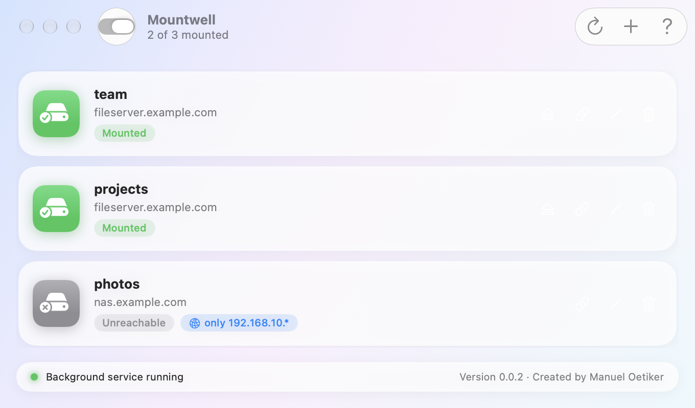
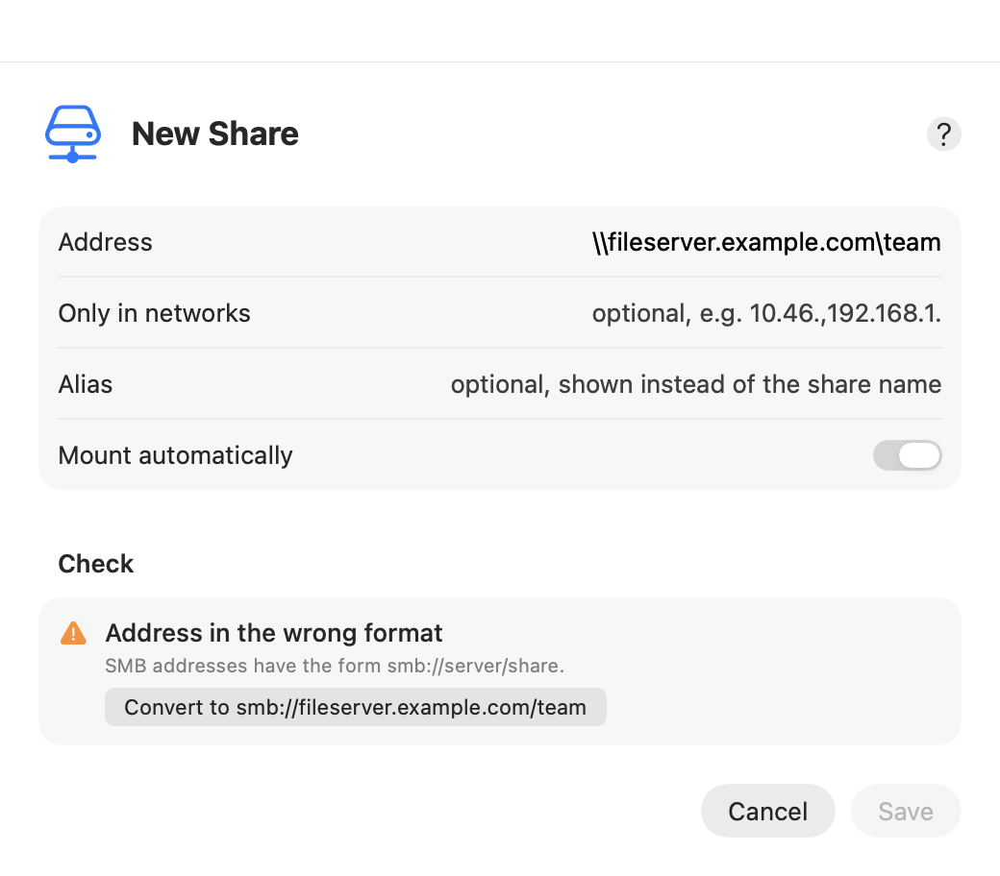
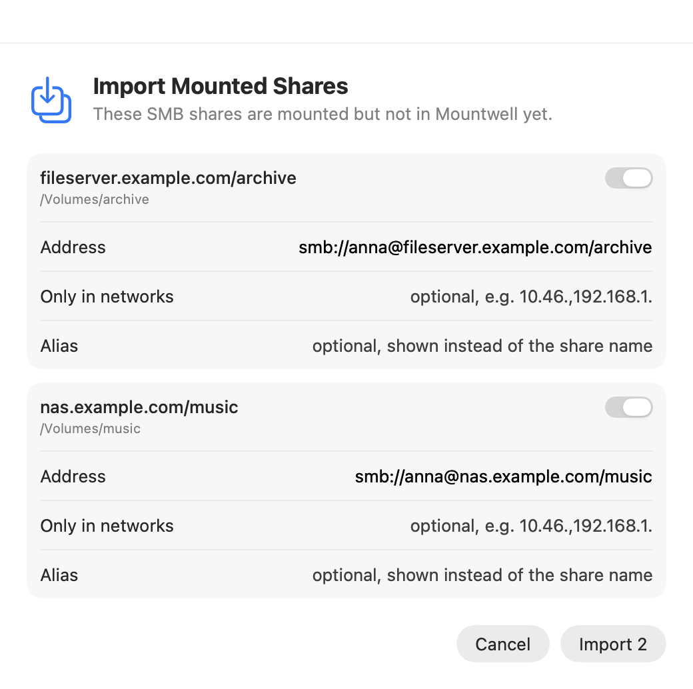

# MountWell

[](https://github.com/moetiker/MountWell/actions/workflows/ci.yml)
[](https://github.com/moetiker/MountWell/releases/latest)

MountWell connects your Mac to the network drives (SMB shares) at work or at home as soon
as their server can be reached, in the office or over VPN. When you leave, it disconnects
them again, so Finder never hangs on a drive that is gone.



You add each drive once. After that MountWell works in the background: open your laptop
in the office or start the VPN, and the drives are there.

It needs macOS 14 or later and runs on Apple silicon and Intel Macs. MountWell shows
itself in English or German, following your Mac's language.

## Install

1. Open the [latest release](https://github.com/moetiker/MountWell/releases/latest) and
   click **MountWell-….pkg** under *Assets* to download it.
2. Double-click the downloaded file in your *Downloads* folder and follow the installer.
   It asks for your Mac password at the end.
3. MountWell opens by itself. From now on it also sits in the menu bar at the top of the
   screen.

With [Homebrew](https://brew.sh), install it in Terminal instead:

```sh
brew tap moetiker/mountwell https://github.com/moetiker/MountWell
brew trust moetiker/mountwell
brew install --cask mountwell
```

MountWell updates itself; Homebrew leaves that to the app.

## Add a drive

1. Click **+** in the MountWell window.
2. Enter the address of the drive, for example `smb://fileserver.example.com/team`. Your
   IT department or the person who set up the server can tell you the address. A Windows
   address such as `\\fileserver\team` works too: MountWell offers to convert it.
3. Optionally give the drive a name of your own under **Alias**, such as "Team Drive".
4. Click **Save**.



While you type, MountWell checks the address and explains what is wrong, for example a
missing server name or a server that cannot be reached right now.

**Save the password once.** Click the chain button on the drive (shown when you move the
mouse over it). Finder asks for your user name and password: tick **Remember this
password in my keychain** and click **Connect**. Without this step MountWell cannot
connect the drive on its own.

## Drives you already use

If you already connected drives in Finder, click the MountWell icon in the menu bar and
choose **Import Mounted Shares…**. MountWell lists every connected drive it does not
know yet; untick the ones you do not want and click **Import**.



## Everyday use

- **The menu bar icon** shows whether drives are connected. Its menu lists your drives;
  each can be shown in Finder, ejected or connected from there.
- **Eject a drive** with the eject button on the drive or in the menu bar. MountWell then
  leaves it alone until you connect it again or leave the network. Ejecting in Finder is
  not enough: MountWell would connect it again within a minute.
- **Switch a drive off** without removing it: right-click it and untick
  **Mount Automatically**. It stays in the list, greyed out.
- **Start at login:** choose **MountWell → Settings…** and turn on **Run at Login**.
  With **Show Window at Login** the window opens too; otherwise MountWell waits in the
  menu bar.
- **Updates:** MountWell tells you when a new version is out. Click **Install** and enter
  your Mac password.

## When something does not work

- Click **?** in the window for help on addresses, passwords and networks.
- **View → Show Log** shows what MountWell did and why.
- A red dot at the bottom left means the background service is not running: click
  **Load**.
- A drive that says *Unreachable* cannot be reached from where you are. Start the VPN or
  go to the network the drive belongs to.

## Uninstall

Open the *Terminal* app, paste this line, press Return and enter your Mac password:

```sh
sudo "/Applications/MountWell.app/Contents/Resources/uninstall.sh"
```

Your list of drives stays in `~/.config/mountwell`, in case you install MountWell again.

Installed with Homebrew: `brew uninstall --cask mountwell`, or with `--zap` to remove the
list of drives and the log as well.

## For administrators

Install without the window:

```sh
sudo installer -pkg MountWell-<version>.pkg -target /
```

The drives are kept in `~/.config/mountwell/shares.conf`, one per line, with an optional
list of IP prefixes and an optional alias after `#`. A leading `!` switches a drive off:

```
smb://fileserver.example.com/team
smb://nas.example.com/photos 192.168.10. # Photos at home
!smb://fileserver.example.com/archive
```

While a server name resolves, the background service remembers the server's IP address,
network and SMB server ID in `~/.config/mountwell/servers.yaml`. If the name later stops
resolving, for example when the VPN's DNS breaks, it connects via that address, from the
same network only and only if the same server answers. Connect once via the address
(right-click the drive) so its password is in the keychain too.

The log is `~/Library/Logs/mountwell.log`. Releases are signed with a Developer ID and
notarized by Apple; the app installs only updates signed by the same developer.

## Development

```sh
./build.sh             # tests, then build/MountWell-<version>.pkg
tools/screenshot.sh    # the pictures in docs/, from the real views
```

- [`docs/spec.md`](docs/spec.md): what MountWell must do
- [`docs/programming-guide.md`](docs/programming-guide.md): architecture, conventions, translation, tests, releases
- [`docs/maintainer-notes.md`](docs/maintainer-notes.md): pitfalls and the reasons behind decisions

## License

MIT, see [LICENSE](LICENSE). Created by Manuel Oetiker.
